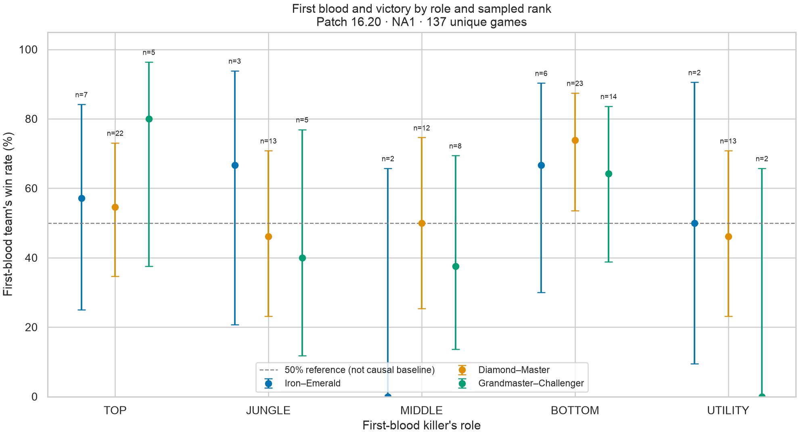
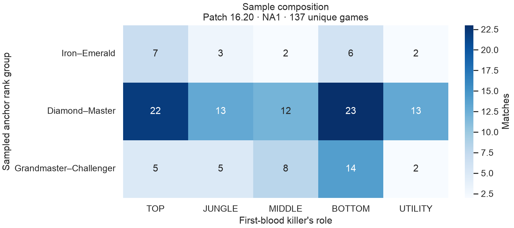

# First blood, role, and victory in League of Legends

**Does the role that secures first blood have an association with that team's
probability of winning, and does that relationship differ across ranked skill levels?**

An exploratory data analytics portfolio project using Python, the official Riot
Games API, SQLite, SQL, pandas, and Matplotlib/Seaborn. It follows the workflow
from API collection and validation to aggregate analysis and communication.

**Pilot result:** 137 eligible ranked solo/duo games on NA1, internal patch
**16.20**, collected from real Riot API responses. The sample is small and uneven:
these results describe the collected games and do not establish statistically
significant differences, causal effects, or population-wide patterns.

## What the pilot shows

Each match contributes one observation: the first-blood killer's role and whether
**that killer's team** won. Rank groups label a sampled anchor player's **current
rank at collection**, not necessarily the killer's rank or historical lobby rank.

| Sampled anchor rank group | Eligible games | Sampled players |
|---|---:|---:|
| Iron–Emerald | 20 | 10 |
| Diamond–Master | 83 | 10 |
| Grandmaster–Challenger | 34 | 10 |
| **Total** | **137** | **30** |

The following examples illustrate both the observed rates and their uncertainty;
they are not a ranking of the best roles:

| Anchor rank group | First-blood role | Wins / games | Win rate | 95% Wilson interval |
|---|---|---:|---:|---|
| Diamond–Master | BOTTOM | 17 / 23 | 73.9% | 53.5%–87.5% |
| Grandmaster–Challenger | TOP | 4 / 5 | 80.0% | 37.6%–96.4% |
| Iron–Emerald | MIDDLE | 0 / 2 | 0.0% | 0.0%–65.8% |

The 80% estimate comes from only five games. Similarly, zero wins in two games
does not imply that the underlying win probability is zero. **Nine of fifteen
role × rank cells have fewer than ten games**, and the largest has only 23.
Although every cell is populated, the uncertainty is too substantial to draw a
reliable conclusion about how role patterns differ across rank groups.



The error bars show uncertainty under an independent-binomial model. The 50%
reference line is not a causal baseline or a significance test.



The heatmap shows why equal numbers of sampled players do not produce equal
numbers of eligible matches. Diamond–Master supplies 83 of the 137 observations;
comparisons should be read alongside these counts.

See [all fifteen estimates](reports/findings.md), [win-rate data](reports/win_rates.csv),
and the [collection manifest](reports/collection.json). All reported numbers and
figures come from the committed pilot outputs; no synthetic results are used.

## Data and collection record

| Item | Recorded value |
|---|---|
| Run ID | `204395aef6dd58c82454` |
| Platform and mode | NA1; ranked solo/duo (`queueId=420`), Summoner's Rift (`mapId=11`), `CLASSIC` |
| Analyzed patch | Internal `gameVersion` / Data Dragon **16.20** |
| Confirmed live patch supplied to collector | Internal **16.21**, citing [Riot's patch 26.21 notes](https://www.leagueoflegends.com/en-us/news/game-updates/league-of-legends-patch-26-21-notes/) |
| Collection window | 2026-10-29 **04:04:17–04:19:50 UTC** (October 28, **21:04–21:19 PDT**) |
| Match-history search window | 2026-09-17 03:56:50 through 2026-10-29 03:56:50 UTC; cutoff exclusive |
| Discovery and filtering | 500 unique candidate matches; 363 excluded for a different patch; 137 eligible |
| Sampling seed | `20261028` |

The search window is a configured history filter, not the observed earliest and
latest eligible match dates. The manifest records one candidate patch, 16.20;
this pilot does not compare multiple patches or demonstrate robustness across them.
Public patch labels and internal game versions can differ. The latest completed
candidate was identified relative to the supplied live patch; Data Dragon asset
publication alone is not proof of a region's rollout date.

## Methodology

### Sampling and rank assignment

1. Read current solo/duo League-v4 ladder entries. For Iron through Diamond,
   use one page per division I–IV; use apex league endpoints for Master,
   Grandmaster, and Challenger. This is a partial ladder sampling frame.
2. Combine tiers into **Iron–Emerald**, **Diamond–Master**, and
   **Grandmaster–Challenger**. Exclude players seen in conflicting tiers during
   the snapshot. Select ten players per group using seeded SHA-256 ordering of
   PUUIDs, then request up to twenty ranked match IDs per player.
3. Deduplicate by match ID. When several sampled players lead to the same game,
   choose the anchor with the lowest seeded PUUID hash **before inspecting the
   role or outcome**. Its current rank group labels that match. Order candidate
   matches by seeded hash; the pilot caps eligible games at 100 per group.

**The group is a sampling label.** Match-v5 does not provide historical participant
ranks. The anchor may be on either team, and the first-blood killer may have a
different rank. Promotions, demotions, and cross-tier matchmaking can all affect
how a historical game is labeled. No average-lobby or killer-rank inference is made.

### First blood and data cleaning

The pipeline checks response IDs, queue, map, mode, exact major.minor patch, and
start-time window. It requires ten unique participant IDs, two five-player teams,
and exactly one of each role per team: **TOP, JUNGLE, MIDDLE, BOTTOM, UTILITY**.
Missing or duplicate roles are excluded rather than inferred from a champion or lane.

First blood is the earliest timeline `CHAMPION_KILL`, cross-checked against the
single participant with `firstBloodKill=true`. The victim must be on the opposing
team. The killer's team ID is compared with the winning team ID, and team and
participant win flags must agree. The anchor's team never substitutes for the
killer's team; assists do not count as securing first blood.

Exclude malformed responses, no-kill games, tied earliest kills, environmental
kills, contradictory flags, invalid timestamps, games under 300 seconds, and
`gameEndedInEarlySurrender` games. This conservative short-game filter can remove
real games. The pilot audit records only different-patch exclusions; other rules
remain part of the pipeline but had no recorded exclusions in this run. Persistent
HTTP errors stop a run rather than silently discarding inaccessible records.

### Pilot settings versus defaults

This local run used **one match per group and one per cell** as minimum completion
thresholds, with ten players per group and twenty histories per player. These
are pilot feasibility settings, **not evidence of adequate statistical power**.
The CLI's larger defaults are 100 matches per group and ten per cell, with thirty
players per group and up to 300 histories each. The published pilot does **not**
meet those larger defaults. The manifest's `status=complete` and `sufficient=true`
mean that the configured pilot thresholds were met, not that the sample supports
statistical conclusions.

### Statistics and limitations

For each cell, calculate wins divided by eligible games and a two-sided **95%
Wilson score confidence interval**. Empty cells would have undefined estimates.
Intervals assume independent binomial observations; repeated players across games
can make them too narrow. They do not correct for convenience sampling.

The [interaction contrasts](reports/interaction_contrasts.csv) compare role-versus-TOP
win-rate differences between an upper rank group and Iron–Emerald. Their unadjusted
Wald intervals are exploratory diagnostics. Tiny or all-win/all-loss cells can make
these approximations unreliable; one interval excluding zero is **not treated as
a validated significance finding**. CI overlap is not an interaction test. No
statistical significance or absence of an effect is established here.

The partial ladder pages, active players, capped histories, shared-match anchors,
current-rank labels, and exclusion rules introduce selection bias. Games share
players, groups have unequal sizes, and the combined Iron–Emerald group is broad.
One region and one patch cannot represent all ranked play. Champion choices,
matchups, team strength, side, and other factors are not controlled. These data
do not show that giving first blood to a particular role **causes** more victories.
A useful follow-up would collect a larger sample under a prespecified design and
assess dependence and sensitivity before making stronger comparisons.

## Explore or reproduce

For a separate collection targeting approximately 5,000 matches, use the
[macOS start, monitor, and resume guide](docs/large-collection.md). Its opt-in
`collect-large` mode freezes manifests and checkpoints results incrementally.
The pilot commands below retain their original behavior and outputs; no large
collection has been launched by this change.

The committed reports and charts can be read without a Riot key. Source and
outputs are organized as follows:

| Location | Purpose |
|---|---|
| `src/firstblood/` | API requests, cleaning, SQLite storage, analysis, and CLI |
| [sql/analysis.sql](sql/analysis.sql) | Win rates, role frequencies, duration/window diagnostics, and integrity checks |
| [notebooks/analysis.ipynb](notebooks/analysis.ipynb) | SQL/pandas exploration of a locally available completed run |
| `reports/` | Aggregate results, provenance, and two figures |
| `tests/` | Offline transformation, API, sampling, storage, and statistical tests |

### Install and test (Python 3.12)

From the repository root:

```bash
cd league-first-blood
python3.12 -m venv .venv
source .venv/bin/activate
source scripts/env.sh
python -m pip install -r requirements.txt
python -m pip install --no-deps -e .
python -m ipykernel install --sys-prefix --name firstblood --display-name 'First Blood (Python 3.12)'
python -m unittest discover -s tests -v
python -m pip check
```

SQLite and `unittest` are part of Python; no database service is needed. The shell
helper keeps writable notebook/plotting configuration in ignored `.local/` paths.
Tests use labeled synthetic fixtures and delete their temporary outputs; those
fixtures are not portfolio data. A regression test covers legacy nonnumeric
Data Dragon versions, which previously interrupted patch selection.

### Authenticate and collect

Get a key from <https://developer.riotgames.com/>. Copy `.env.example` to an
ignored local `.env`, edit it privately, and restrict its permissions, or configure
`RIOT_API_KEY` securely as an HTTPS secret in environment settings. Never commit
or print a credential. In cloud environments the variable may contain an opaque
binding substituted by the HTTPS proxy on allowed Riot hosts; forward it unchanged
in `X-Riot-Token` rather than assuming it is a raw key.

```bash
firstblood auth-check --platform na1
```

The check bypasses cached responses and emits sanitized diagnostics. The older
[cloud authentication report](reports/authentication.json) records a historical
Cloudflare block from this environment; it is not the status of the later,
successful local collection. A future HTML 403 cannot by itself establish that
a key expired. Required hosts are `ddragon.leagueoflegends.com`,
`na1.api.riotgames.com`, and `americas.api.riotgames.com` for this NA1 study.

The original pilot command settings are recorded below. Reuse the private cache
and database for an exact resume; a new live request now can return a different
ladder snapshot or history. For a new study, confirm the region's current internal
patch and an official Riot source, choose a new UTC cutoff, and decide sampling
settings before inspecting outcomes. Do not mistake the old confirmation for
current rollout information.

```bash
firstblood collect \
  --platform na1 --current-patch 16.21 \
  --patch-source https://www.leagueoflegends.com/en-us/news/game-updates/league-of-legends-patch-26-21-notes/ \
  --as-of 2026-10-29T03:56:50Z --seed 20261028 \
  --lookback-days 42 --patch-candidates 1 --league-pages 1 \
  --players-per-group 10 --matches-per-player 20 \
  --max-matches-per-group 100 --min-matches-per-group 1 --min-matches-per-cell 1

# Use the ID printed by collection. The committed pilot's ID is shown here.
firstblood status --run-id 204395aef6dd58c82454
firstblood analyze --run-id 204395aef6dd58c82454 --output .local/reproduced-reports
```

The collector respects Riot rate-limit windows and `Retry-After`, uses bounded
retries and TLS verification, and privately caches successful JSON responses.
Retain the original SQLite database and raw cache for exact replay. Neither is
committed here: **this review verifies the aggregate outputs, not the underlying
private match records**. Recollection may differ, and the seed alone cannot
reconstruct a historical ladder. Share aggregate outputs rather than raw player
identifiers. Use a separate cache/database for an independent study.

With the private completed database available, execute the notebook from the
project directory:

```bash
export FIRSTBLOOD_RUN_ID=204395aef6dd58c82454
jupyter nbconvert --to notebook --execute notebooks/analysis.ipynb \
  --output analysis.executed.ipynb --output-dir .local
```

Without that database the notebook reports pending local data; the committed
reports remain available. To analyze SQL directly, bind `:run_id` in
`sql/analysis.sql` using Python's `sqlite3` module or a SQLite client.

This project uses Riot Games' official APIs and is not endorsed by Riot Games.
